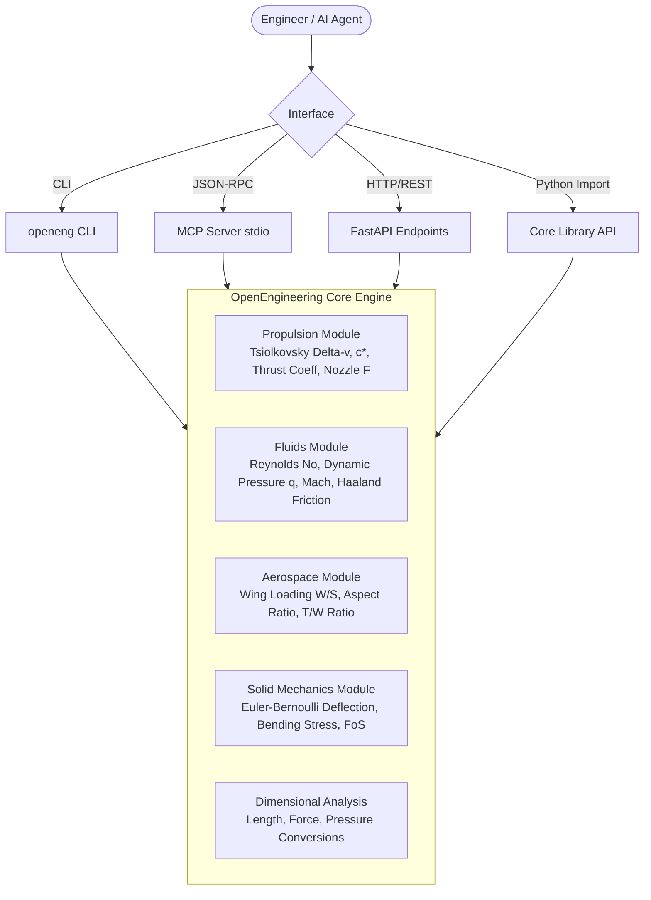

# OpenEngineering Toolkit 📐🚀

[](https://github.com/perfectalone375/openengineering-toolkit/actions)
[](https://www.python.org/)
[](https://opensource.org/licenses/MIT)
[](https://modelcontextprotocol.io/)
[](https://github.com/astral-sh/ruff)
[](tests/)

Transparent, verified computational engineering mechanics, aerospace sizing, fluid dynamics, and rocket propulsion library for Python.

Includes **Command-Line Interface (`openeng`)**, **REST API (FastAPI)**, and **Model Context Protocol (MCP)** server for seamless integration with AI coding agents (Claude Desktop, Cursor, Antigravity).

---

## 🛠️ Architecture Overview



---

## 🚀 Key Modules & Analytical Capabilities

### 1. Rocket Propulsion (`openengineering.propulsion`)
* **Tsiolkovsky Delta-V:** $\Delta v = I_{sp} g_0 \ln\left(rac{m_0}{m_f}
ight)$ with strict propellant fraction validation.
* **Characteristic Exhaust Velocity ($c^*$):** Theoretical chamber speed from gas heat ratio $\gamma$, molecular weight, and chamber temperature $T_c$.
* **Nozzle Thrust Coefficient ($C_F$):** Evaluates momentum expansion and pressure mismatch terms $(p_e - p_a)/p_c \cdot \epsilon$.
* **Total Thrust Force:** $F = \dot{m} v_e + (p_e - p_a) A_e$.

### 2. Fluid Dynamics & Aerodynamics (`openengineering.fluids` & `aerospace`)
* **Reynolds Number:** $Re = rac{
ho v L}{\mu}$ for boundary layer regime identification (laminar vs turbulent).
* **Dynamic Pressure:** $q = rac{1}{2} 
ho v^2$.
* **Compressible Flow Mach Number:** $M = rac{v}{\sqrt{\gamma R T}}$ and total-to-static pressure ratio $P_0/P$.
* **Haaland Turbulent Pipe Friction:** Explicit Darcy friction factor $f$.
* **Aircraft Preliminary Sizing:** Wing loading $W/S$, geometric aspect ratio $b^2/S$, and thrust-to-weight $T/W$.

### 3. Compressible Gas Dynamics & Shock Waves (`openengineering.compressible`)
* **Isentropic Ratios:** Total-to-static temperature ($T_0/T$), total-to-static density ($\rho_0/\rho$), and sonic throat area ratio ($A/A^*$) for nozzle expansion.
* **1D Normal Shock Mechanics (Rankine-Hugoniot):** Downstream Mach $M_2$, static pressure jump $P_2/P_1$, and total pressure loss $P_{02}/P_{01}$.
* **Prandtl-Meyer Supersonic Expansion:** Exact expansion angle $\nu(M)$ in degrees for supersonic flow around convex corners.
* **API & MCP:** Exposed at `/fluids/compressible/` and via `openeng_compressible_isentropic` & `openeng_normal_shock` tools.

### 4. Structural Mechanics & Beams (`openengineering.beam` & `mechanics`)
* **Euler-Bernoulli Simply-Supported Deflection:** $\delta_{\max} = \frac{P L^3}{48 E I}$.
* **Maximum Bending Stress:** $\sigma = \frac{|M| c}{I}$.
* **Factor of Safety:** $FoS = \frac{\sigma_{\text{allowable}}}{\sigma_{\text{actual}}}$.

### 5. Verified Dimensional Analysis (`openengineering.units`)
* Robust SI, Imperial, and US Customary unit conversions for Length (`m`, `mm`, `ft`, `in`), Force (`N`, `kN`, `lbf`), and Pressure (`Pa`, `kPa`, `MPa`, `bar`, `psi`, `atm`).

---

## ⚡ Quick Start

### Installation

```bash
# Clone and install in editable mode with all dev & API tools
git clone https://github.com/perfectalone375/openengineering-toolkit.git
cd openengineering-toolkit
pip install -e ".[api,dev]"
```

### Python API Example

```python
from openengineering import (
    tsiolkovsky_delta_v,
    reynolds_number,
    simply_supported_center_load_max_deflection,
    convert_pressure,
)

# 1. Rocket stage delta-v
dv = tsiolkovsky_delta_v(isp_s=320, initial_mass_kg=5000, dry_mass_kg=1200)
print(f"Stage Delta-V: {dv:.1f} m/s")

# 2. Aerodynamic Reynolds number for 1.5m wing chord at 60 m/s
re = reynolds_number(
    density_kg_m3=1.225,
    velocity_m_s=60.0,
    characteristic_length_m=1.5,
    dynamic_viscosity_pa_s=1.789e-5,
)
print(f"Reynolds Number: {re:.2e}")

# 3. Steel I-beam mid-span deflection under 5 kN load across 4 m span
defl = simply_supported_center_load_max_deflection(
    load_n=5000, span_m=4.0, elastic_modulus_pa=210e9, second_moment_m4=8.5e-6
)
print(f"Mid-span deflection: {defl * 1000:.3f} mm")
```

---

## 💻 Command Line Interface (`openeng`)

```bash
# Rocket delta-v
openeng deltav --isp 311 --m0 12500 --mf 2100

# Beam deflection
openeng beam-deflection --load 2500 --span 3.5 --modulus 200e9 --inertia 2.5e-6

# Reynolds number
openeng reynolds --density 1.225 --velocity 85 --length 2.1

# Dynamic pressure
openeng q --density 1.225 --velocity 120

# Unit conversions
openeng convert --type pressure --value 35 --from-unit psi --to-unit bar
```

---

## 🤖 Model Context Protocol (MCP) Integration

The toolkit includes a native stdio MCP server enabling AI coding assistants to invoke deterministic engineering formulas without hallucinations:

### Claude Desktop / Cursor Config (`mcp.json`)

```json
{
  "mcpServers": {
    "openengineering": {
      "command": "openeng-mcp",
      "args": []
    }
  }
}
```

### Available MCP Tools

| Tool Name | Parameters | Description |
|---|---|---|
| `openeng_deltav` | `isp_s`, `initial_mass_kg`, `dry_mass_kg` | Computes rocket Delta-V (m/s and km/s) |
| `openeng_beam_deflection` | `load_n`, `span_m`, `elastic_modulus_pa`, `second_moment_m4` | Computes mid-span beam deflection |
| `openeng_reynolds` | `density_kg_m3`, `velocity_m_s`, `length_m`, `viscosity_pa_s` | Computes Reynolds number and regime |
| `openeng_unit_convert` | `category`, `value`, `from_unit`, `to_unit` | Converts engineering dimensions safely |

---

## 🧪 Testing & Verification

The suite enforces 100% passing tests and strict Ruff linting across Python 3.10, 3.11, and 3.12:

```bash
# Run pytest test suite
pytest

# Run Ruff code analysis
ruff check .
```

---

## 📄 License

This project is licensed under the **MIT License** - see the [LICENSE](LICENSE) file for details.

Developed with precision by **[Gopi Naga Vignesh Thirupati](https://github.com/perfectalone375)**.
